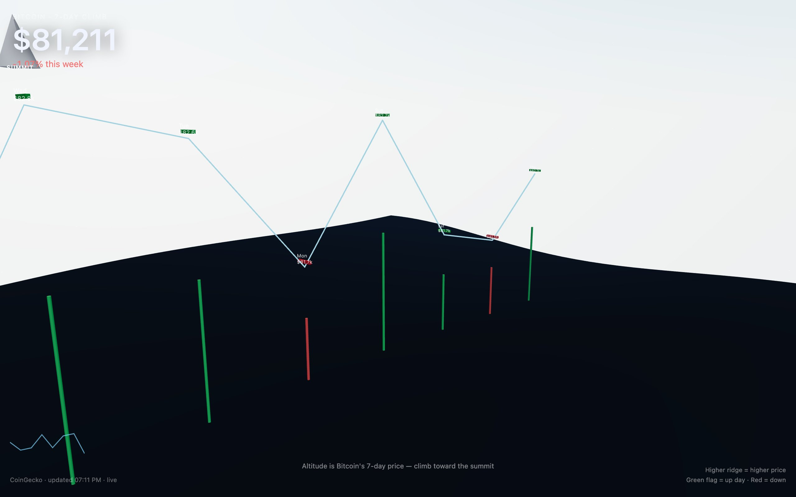

<div align="center">

<h1>summit</h1>

<p><b>Bitcoin's week, drawn as a mountain ridge.</b></p>

<p><i>Each flag is a daily close from CoinGecko; the higher the price, the higher the ridge.</i></p>

<h6>


</h6>

<a href="https://summit.parthchandak.info"><b>Live demo</b></a> ·
<a href="#how-it-works"><b>How it works</b></a> ·
<a href="#run-it"><b>Run it</b></a>

<br><br>

<a href="https://summit.parthchandak.info"></a>

<sub>Live capture, 22 October 2026. Real CoinGecko prices, not a demo.</sub>

</div>

<br>

A one-day sketch from a "creative daily" series. It fetches the last seven days of Bitcoin
prices from the free [CoinGecko](https://www.coingecko.com/en/api) `market_chart` endpoint,
keeps the last price of each calendar day, and builds a ridge line out of them in a React
Three Fiber scene. The current price and the week's change sit top-left as the headline
number. No API key is needed.

## How it works

| Data | Drives |
|---|---|
| Daily close (last price of each day) | Height of each ridge point: the week's low to high maps to 0 to 6 scene units |
| Close vs. the previous day | Flag colour: green for an up day, red for a down day |
| Day of the week | Position along the ridge, oldest to newest |
| Latest price | The headline number and the climber's position at the end of the ridge |
| Highest close | Where the `SUMMIT` cone is placed |

The page polls every 60 seconds. If CoinGecko is unreachable it shows a synthetic week around
$95,000 and the stamp bottom-left reads `fallback` instead of `live`. The camera drifts
slightly; with `prefers-reduced-motion` it holds still.

Rough edges, left as shipped: the flag poles hang below their flags instead of reaching the
ground, and at some viewport sizes the summit cone sits behind the headline price.

## Run it

```bash
git clone https://github.com/parthchandak02/summit.git
cd summit
npm install
npm run dev      # local dev server
npm run build    # static site in dist/
```

The live version runs on Cloudflare Pages.

<details>
<summary><b>Project layout</b></summary>

```
src/App.tsx   Data fetch, scene (terrain, ridge, flags, climber, summit) and overlays
src/App.css   Headline, sparkline, stamp and legend styles
brief.md      The original creative brief: concept and data-to-visual encoding
```

</details>

<br>

<div align="center">
<sub>Built with React Three Fiber, drei, TypeScript and Vite. Data from CoinGecko.</sub>
</div>
